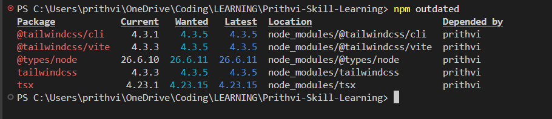

# 📦 Updating Packages Using NPM

Packages installed in our project can receive updates over time. Developers release new versions to **fix bugs, add features, improve performance, and patch security vulnerabilities.**

NPM allows us to check and update our installed packages.

## Useful Commands

| Command | Purpose |
|---|---|
| `npm outdated` | Checks for outdated packages. |
| `npm update` | Updates local packages within allowed version ranges. |
| `npm update package-name` | Updates a specific local package. |
| `npm install package-name@latest` | Installs the latest version of a package. |
| `npm update -g` | Updates global packages. |
| `npm update -g package-name` | Updates a specific global package. |

---

## 1. Checking Outdated Packages

To check which packages have newer versions available, we use:

```bash
npm outdated
```

It displays information such as:

- **Current** → Version currently installed in our project.
- **Wanted** → Latest version allowed by our `package.json` version range.
- **Latest** → Latest version available on the NPM registry.


---

## 2. Updating Packages

To update packages according to the version ranges specified in `package.json`, use:

```bash
npm update
```

This updates the packages within the allowed version range, and updates the `package-lock.json` accordingly.

> 🟡 `npm update` generally does not install major updates that fall outside your specified version range.

---

## 3. Updating a Specific Package

We can also update a particular package instead of updating all packages.

```bash
npm update package-name
```

### Example

```bash
npm update express
```

This updates Express to the latest version allowed by the version range specified in our `package.json`.

---

## 4. Installing the Latest Version

If we want to install the latest version of a package, including a version outside the current allowed range, we can use:

```bash
npm install package-name@latest
```

### Example

```bash
npm install express@latest
```

This installs the latest version of Express and updates the dependency version in `package.json` and `package-lock.json`.

> 🔴 Major updates can introduce breaking changes, so our code may need modifications after updating.

---

## 5. Updating Global Packages

To update globally installed packages, use:

```bash
npm update -g
```

To update a specific global package:

```bash
npm update -g package-name
```

Example:

```bash
npm update -g nodemon
```

---

## 💡 Remember

- 🟢 **Check** updates using `npm outdated`.
- 🔵 **Update** packages using `npm update`.
- 🟠 **Latest version** using `npm install package-name@latest`.
- 🔴 Always be careful when updating major versions because they may introduce breaking changes.

